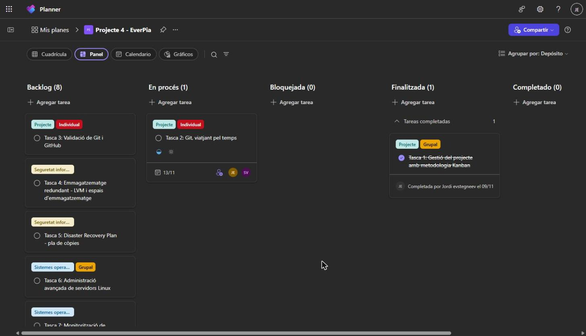
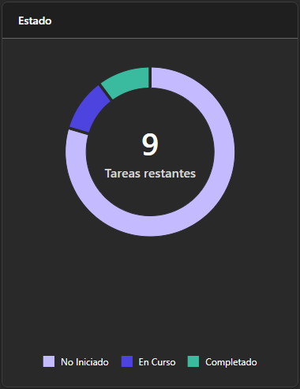
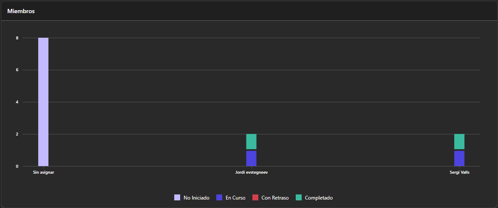
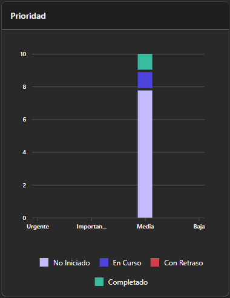

# Tasca 1: Kanban del projecte

**Membres del grup:** Jordi Evstegneev i Sergi Novell

**Enllaç al Kanban (Planner):** [Kanban Projecte 4 - EverPia](https://planner.cloud.microsoft/ui/web/plan/kW8Ct2mIqky2bRyh_KPKq5YAE1Zq/view/board?tid=c7b5981a-7820-4ac8-ae65-03515ea81317)

## Com funciona el Kanban

| Columna | Què hi posem |
|---------|--------------|
| Backlog | Totes les tasques del projecte que encara no hem començat (per fer). |
| En procés | Les tasques que estem fent ara. Quan una tasca passa aquí, l'assignem a una persona i li posem una data de venciment. |
| Bloquejada | Tasques aturades per algun imprevist. Les marquem amb l'etiqueta "Imprevist" i hi posem la solució proposada. |
| Finalitzada | Tasques acabades. Planner guarda la data real de finalització i no canviem la data de venciment. Així podem veure si hem anat a temps o amb retard. |

Les etiquetes de cada tasca indiquen de quin mòdul és i si és Individual o Grupal.

---

## 1. Relació de tasques del backlog

| Núm. | Tasca | Descripció breu |
|------|-------|-----------------|
| 1 | Gestió del projecte amb metodologia Kanban | Crear el Kanban al Planner, omplir el backlog i fer-ne el seguiment durant tot el projecte. |
| 2 | Git, viatjant pel temps | Practicar l'ús de Git: commits, historial, branques i recuperació de versions anteriors. |
| 3 | Validació de git i GitHub | Demostrar el domini de Git i GitHub per obtenir la insígnia d'EverPia. |
| 4 | Emmagatzematge redundant: LVM i espais d'emmagatzematge | Configurar emmagatzematge redundant amb LVM (Linux) i Espais d'emmagatzematge (Windows). |
| 5 | Disaster Recovery Plan: pla de còpies | Dissenyar i documentar un pla de còpies de seguretat i recuperació. |
| 6 | Administració avançada de servidors Linux | Instal·lar i comparar gestors gràfics web per administrar un servidor Ubuntu. |
| 7 | Monitorització de servidors Linux | Instal·lar i configurar eines de monitorització de servidors Linux. |
| 8 | Repte RACC | Treballar el repte Joves i Mobilitat proposat pel RACC. |
| 9 | Instal·lant un servidor de noms | Implantar un servei DNS intern per al client DigiCore. |
| 10 | ODS i el sector IT: el costat sostenible d'EverPia | Analitzar l'impacte dels serveis IT sobre els Objectius de Desenvolupament Sostenible. |

---

## 2. Estat del Kanban

### Setmana 1 (divendres 13/11/2026)

**Què hem fet aquesta setmana:**

- Hem creat el Kanban al Planner amb la plantilla Plan Simple, l'hem fet públic i l'hem compartit amb el company.
- Hem omplert el backlog amb les 10 tasques del projecte, cadascuna amb títol, descripció breu i etiquetes.
- Tasca 1 (Kanban): Finalitzada el 09/11, assignada a tots dos.
- Tasca 2 (Git, viatjant pel temps): En procés, assignada a Jordi i Sergi, data de venciment 13/11.
- La resta de tasques (3 a 10) són al Backlog.

### Setmana 2 (divendres 20/11/2026)

**Què hem fet aquesta setmana:**

- (pendent d'omplir)

### Setmana 3 (divendres 27/11/2026)

**Què hem fet aquesta setmana:**

- (pendent d'omplir)

### Estat final del projecte (DD/MM/AAAA)

**Què hem fet aquesta setmana:**

- (pendent d'omplir)

---

## 3. Gràfics de resum del projecte

### Estat de les tasques

### Tasques per membre

### Prioritat de les tasques

