# Tasca 2: Solucions

## Part 1: Bones pràctiques en commits

Creem el `README.md` i el fitxer `00-installer-config.yaml` i fem els commits seguint la convenció de missatges (`docs:` i `feat:`):

```bash
git add README.md
git commit -m "docs: inicialitza la repositori de prova per tasca 2"

git add 00-installer-config.yaml
git commit -m "feat: afegeix configuració de xarxa amb DHCP a enps03"
```

**Explicació:** Docs és documentació i feat és una funcionalitat nova. Els missatges segueixen el format "tipus: descripció".

---

## Part 2: L'historial del repositori

```bash
git log
git log --oneline
git show HEAD
```

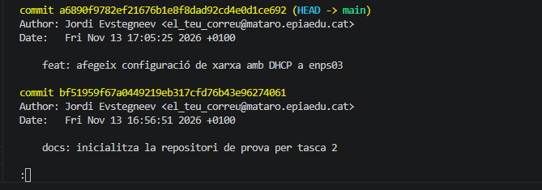

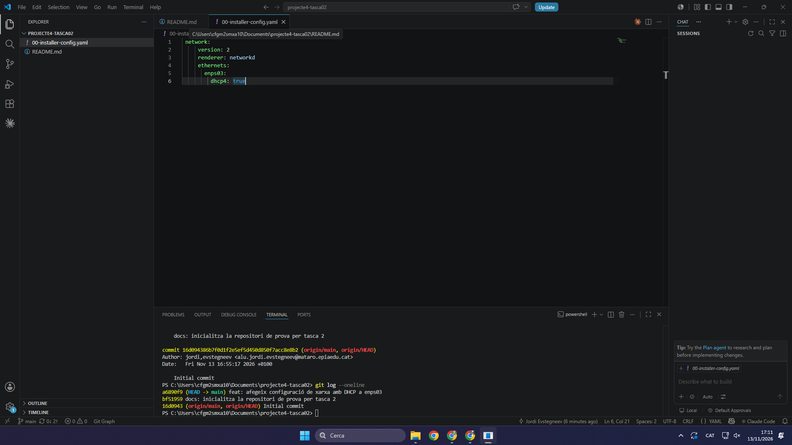

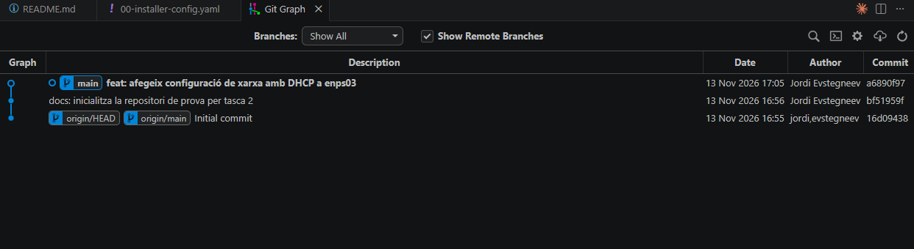

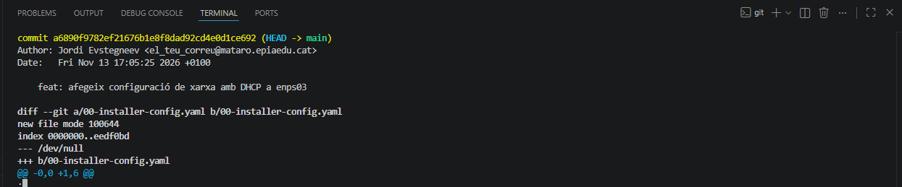

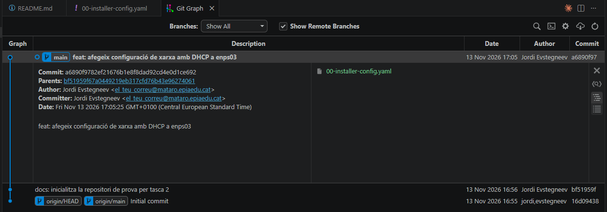

**Explicació:** Git log mostra el hash, l'autor, el correu, la data i el missatge de cada commit. git log --oneline només mostra el hash curt i el missatge. HEAD apunta al darrer commit.

---

## Part 3: Recuperar el working directory

```bash
git status
git restore 00-installer-config.yaml
git status
```

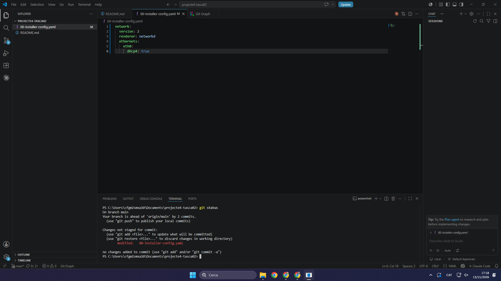

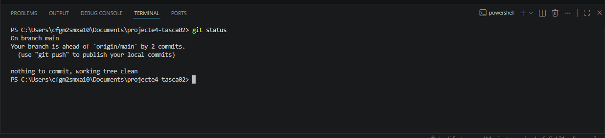

**Explicació:** Git restore desfà els canvis del working directory que encara no tenen commit. Després el git status surt net.

---

## Part 4: Recuperar commits anteriors

### Els tres commits nous

```bash
git commit -am "feat: configura IP estàtica a enps03"
git commit -am "feat: afegeix interfície enps08 amb DHCP"
git commit -am "fix: canvia el servidor DNS de enps03 a 8.8.8.8"
git log --oneline
```

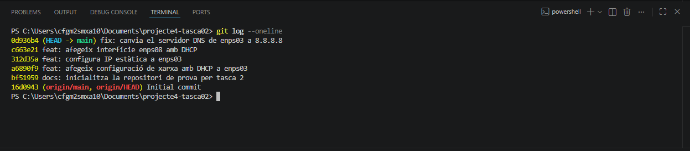

### Revert

```bash
git revert --no-commit HEAD~3..HEAD
git commit -m "revert: torna a la configuració DHCP inicial de enps03"
```

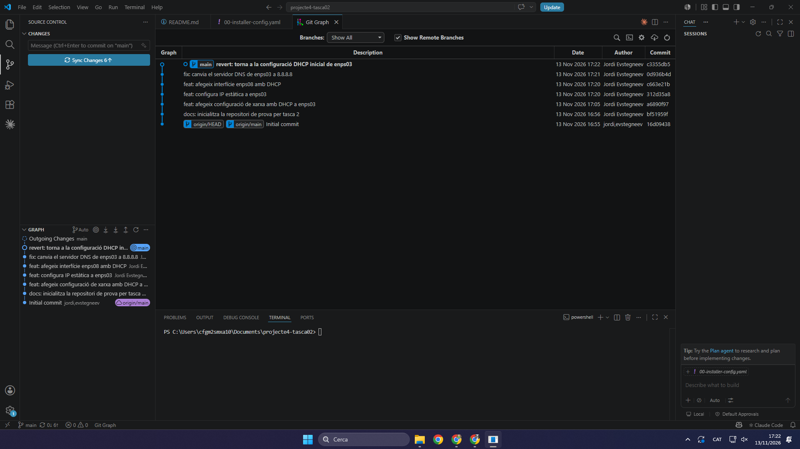

### Explorar un commit anterior

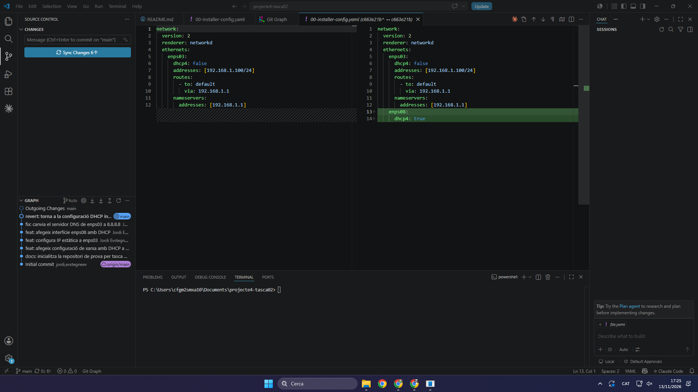

### Reset

```bash
git log --oneline
git reset --hard HEAD~1
git status
git log --oneline
```

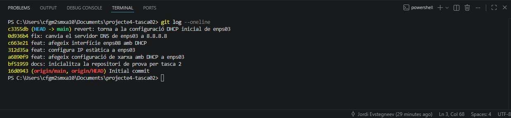

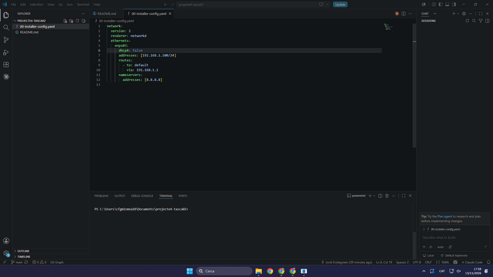

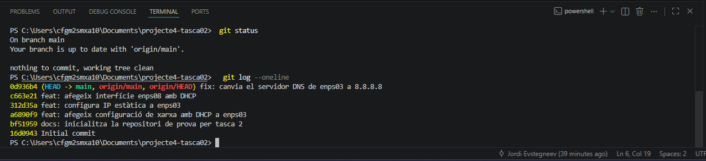

**Explicació:** El revert no esborra commits, en crea un de nou que desfà els canvis. El reset sí que esborra el commit, per això no es recomana.
