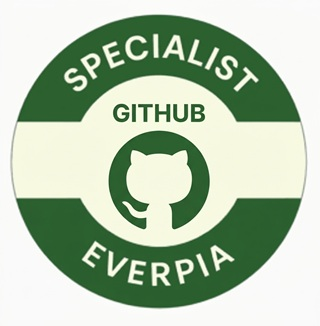

# Tasca 3: Validació de git i GitHub

> Enunciat original: <https://github.com/SMX-ProjecteIntermodular/Projecte4/blob/main/activitats/Tasca03-ValidacioGit.md>

## Enunciat

## Presentació de l'activitat

Benvingut, equip.

Des de la vostra arribada a EverPia com alumnes de pràctiques i actualment com consultors júnir, heu estat treballant amb control de versions usant les eines més populars del mercat: Git i GitHub. Durant aquest temps, heu après a utilitzar aquestes eines per gestionar el codi font dels projectes en els quals heu estat treballant, així com a documentar usant els repositoris en el format Markdown.

Ara ha arribat el moment de validar els vostres coneixements i habilitats adquirides en el treball amb Git i GitHub, mitjançant una prova que us permitirà assolir l'insígnia "EverPia GitHub Specialist".

Aquesta insígnia serà reconeixement al vostre domini de les eines de control de versions i a la vostra capacitat per treballar de manera eficient en entorns col·laboratius.

### Durada de l'activitat

La durada prevista de l'activitat és 2 hores a classe.

### Objectius específics de l'activitat

- Gestionar un repositori mitjançant Git i GitHub.
- Generació de documentació en format Markdown.

### Competències treballades

j) Elaborar documentació tècnica i administrativa del sistema, complint les normes i reglamentació del sector, per al seu manteniment i l’assistència al client.

m) Organitzar i desenvolupar el treball assignat mantenint unes relacions professionals adequades en l’entorn de treball.

### Resultats d'aprenentatge i criteris d'avaluació

- 1713.4. Realitza el seguiment de l'execució de les activitats plantejades, verificant que es compleix amb la planificació.
- 1713.5. Transmet informació amb claredat, de manera ordenada i estructurada.

#### Criteris d'avaluació

4.6 Defineix i elabora la documentació necessària per a l'avaluació de les activitats i del projecte en el seu conjunt.

5.1 Manté una actitud ordenada i metòdica en la transmissió de la informació.

5.4 Coneix els termes tècnics en altres llengües que siguin estàndards del sector.

### Continguts

- Control de versions.
- Format Markdown.

### Capacitats clau treballades

- Autonomia
- Organització del treball
- Resolució de problemes
- Responsabilitat

### Semàfor ús de la IA

🔴 Ús No Permès

## Enunciat de l'activitat

A partir de l'enunciat de l'activitat, haureu de resoldre una sèrie d'accions relatives al control de versions amb Git i GitHub, així com a la generació de documentació en format Markdown.

### Requeriments previs

- Compte de GitHub actiu
- Git instal·lat al vostre ordinador
- Editor VS Code

### Què cal lliurar, on i com?

- Repositori corresponent a la prova d'avaluació individual pràctica.
- Enllaçeu el vostre repositori a la tasca corresponent al Moodle de Projecte Intermodular.
